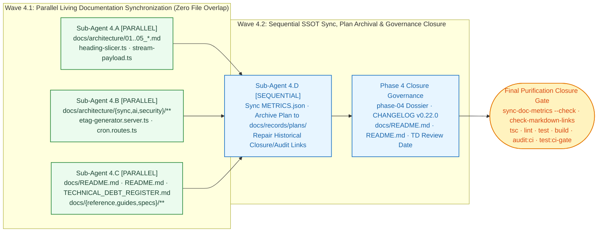

# Phase 4 Closure Dossier: Align Living Architecture Specs, Subsystem Docs, Guides & Technical Debt Register

| Standard Field | Value |
| :--- | :--- |
| **Phase** | `Phase 4: Align Living Architecture Specs, Subsystem Docs, Guides & Technical Debt Register` |
| **Milestone / Version** | `v0.22.0` |
| **Status** | `CLOSED / VERIFIED` ✅ |
| **Closure Date** | `2026-11-15` |
| **Governing Plan** | [`elixent-nextjs-decoupling-and-clean-architecture-plan.md`](../../plans/elixent-nextjs-decoupling-and-clean-architecture-plan.md) (`ELIXENT-NEXTJS-DECOUPLING-CLEAN-ARCH-PLAN-v1.5` — 100% Completed & Archived) |
| **Associated ADRs** | [`ADR-006: Unified Vite TanStack Hono RPC Architecture`](../../../architecture/adrs/adr_006_unified_vite_tanstack_hono_rpc_architecture.md) (`v1.2`) · [`ADR-007: Dual-Plane Separation & ALS Request Context`](../../../architecture/adrs/adr_007_dual_plane_separation_and_als_request_context.md) (`v1.1`) · [`ADR-008: Local-First Cookie Identity & Conditional Flushing`](../../../architecture/01_architecture_vision_and_adrs.md#37-adr-008-local-first-cookie-identity-verification--conditional-react-state-flushing-on-conflict-and-server-fetch) |
| **SSOT Architecture & Reference Suite** | [`01_architecture_vision_and_adrs.md`](../../../architecture/01_architecture_vision_and_adrs.md) · [`sync-api.md`](../../../reference/sync-api.md) · [`ui-streaming-readiness.md`](../../../reference/ui-streaming-readiness.md) · [`TECHNICAL_DEBT_REGISTER.md`](../../../TECHNICAL_DEBT_REGISTER.md) |

---

## 1. Executive Summary

Phase 4 completes the **Next.js Decoupling & Clean Architecture Plan** by synchronizing the entire living documentation corpus, subsystem architecture specifications, developer guides, technical debt register, and canonical verification metrics with the purified **Vite 6 SPA + TanStack Router + Hono 4.13** codebase:

1. **Core Architecture Specs & Core JSDocs (`Sub-Agent 4.A` — Wave 4.1):**
   - Aligned [`01_architecture_vision_and_adrs.md`](../../../architecture/01_architecture_vision_and_adrs.md) through [`05_data_contracts_and_lugx_migration_plan.md`](../../../architecture/05_data_contracts_and_lugx_migration_plan.md) to the `Vite 6 SPA + TanStack Router` client, `Hono 4.13` Node.js server (`src/server/routes/agent.routes.ts`), and `AsyncLocalStorage` `scheduleAfterResponse()` settlement flusher, while adding an archival banner above the historical `src/app/**` migration table in `05_data_contracts_and_lugx_migration_plan.md` (`§§3.2–4`).
   - Preserved intentional references to active npm dependencies `Vercel AI SDK` (`"ai": "^7.0.0"` / `"@ai-sdk/google"`) across `01_architecture_vision_and_adrs.md` and `02_agent_orchestration_and_decision_engine.md`.
   - Updated core JSDoc invariants in `src/core/ast/heading-slicer.ts` (`browser client-side bundle safety`) and `src/core/agent/stream-payload.ts` (`external UI frameworks`).
2. **Subsystem Architecture Specs & Server JSDocs (`Sub-Agent 4.B` — Wave 4.1):**
   - Aligned `docs/architecture/sync/**`, `docs/architecture/ai/**`, and `docs/architecture/security/**` to Hono REST route syntax (`:id` replacing `[id]`), `/api/agent/stream` (`src/server/routes/agent.routes.ts`), Hono RPC domain operations (`src/server/actions/files.ts`, `folders.ts`, `vault-actions.ts` via `src/server/routes/rpc.routes.ts`), and the active Multi-Hunk Ghost modules (`src/components/editor/markdown/streaming-ghost.ts`, `src/components/editor/markdown/types.ts`, `src/hooks/use-editor-autosave.ts`).
   - Updated JSDoc headers in `src/lib/sync/etag-generator.server.ts` (`Hono RPC endpoints`) and `src/server/routes/cron.routes.ts` (`HTTP cron schedulers`).
3. **Indices, Technical Debt Register, Reference Contracts, Guides & Specs (`Sub-Agent 4.C` — Wave 4.1):**
   - Synchronized [`README.md`](../../../../README.md), [`docs/README.md`](../../../README.md), and [`TECHNICAL_DEBT_REGISTER.md`](../../../TECHNICAL_DEBT_REGISTER.md) (appending `ADR-006` post-migration addenda to `TD-04`, `TD-05`, `TD-07`, `TD-09`, `TD-11`, `TD-12`, and `TD-15`, updating `TD-19` to `src/client/routes/editor-page.tsx`, and advancing `Last reviewed:` to `2026-11-15` / `v0.22.0`).
   - Aligned [`sync-api.md`](../../../reference/sync-api.md), [`test-database-isolation.md`](../../../reference/test-database-isolation.md), [`ui-streaming-readiness.md`](../../../reference/ui-streaming-readiness.md), billing/editor guides (`docs/guides/**`), and blueprint specs (`docs/specs/**`).
4. **Metrics Sync, Link Integrity & Plan Archival (`Sub-Agent 4.D` — Wave 4.2 + Final Closure):**
   - Synchronized [`METRICS.json`](../../../METRICS.json) (`146` unit suites / `3,007` tests · `21` live suites / `105` tests · `14` E2E specs / `15` journeys) and all 7 monitored living documents via `scripts/sync-doc-metrics.mjs`.
   - Archived the completed decoupling plan from `docs/Plans/ELIXENT_NEXTJS_DECOUPLING_AND_CLEAN_ARCHITECTURE_PLAN.md` to [`docs/records/plans/elixent-nextjs-decoupling-and-clean-architecture-plan.md`](../../plans/elixent-nextjs-decoupling-and-clean-architecture-plan.md) and updated all plan links across [`CHANGELOG.md`](../../../CHANGELOG.md), [`nextjs-decoupling-phases-1-and-2-forensic-audit.md`](../../audits/nextjs-decoupling-phases-1-and-2-forensic-audit.md), and Phase 1–3 closure dossiers (`phase-01` through `phase-03`).
   - Added release `v0.22.0` to `docs/CHANGELOG.md` and issued this Phase 4 closure dossier, completing the entire Next.js Decoupling & Clean Architecture Plan (`Phases 1, 2, 2.5, 2.6, 3 & 4`).

---

## 2. Phase 4 Execution Topology & Wave Isolation



---

## 3. Sub-Agent Execution & Verification Matrix

| Task ID | Execution Mode | Scope & Target Files | Alignment Summary | Status |
| :--- | :---: | :--- | :--- | :---: |
| **Sub-Agent 4.A** | `[PARALLEL]` (Wave 4.1) | `docs/architecture/01_architecture_vision_and_adrs.md`<br>`docs/architecture/02_agent_orchestration_and_decision_engine.md`<br>`docs/architecture/03_workspace_ast_editor_and_vault_integration.md`<br>`docs/architecture/04_credit_metering_and_settlement_architecture.md`<br>`docs/architecture/05_data_contracts_and_lugx_migration_plan.md`<br>`src/core/ast/heading-slicer.ts`<br>`src/core/agent/stream-payload.ts` | Replaced Next.js 16 / Vercel Serverless / `after()` / `maxDuration` / `next/*` drift with Vite 6 SPA, TanStack Router, Hono 4.13, `scheduleAfterResponse()`, and browser bundle safety; annotated `NEXTAUTH_SECRET` as deprecated legacy alias; preserved active `Vercel AI SDK` references; added historical `ADR-006` archival note in `05_data_contracts`. | **PASS ✅** |
| **Sub-Agent 4.B** | `[PARALLEL]` (Wave 4.1) | `docs/architecture/sync/{three-way-conflict-resolution,editor-sync-orchestration,file-ownership-and-versioning,sync-architecture-overview}.md`<br>`docs/architecture/ai/{ai-streaming-protocol,ai-quota-reservation-lifecycle,ai-atomic-commit-architecture}.md`<br>`docs/architecture/security/security-and-rate-limiting.md`<br>`src/lib/sync/etag-generator.server.ts`<br>`src/server/routes/cron.routes.ts` | Standardized `[id]` -> `:id`, `/api/ai/stream` -> `/api/agent/stream` (`src/server/routes/agent.routes.ts`), `commitAIFileOperation` -> `useEditorAutosave` + `PUT /api/files/:id` + `ai-settlement-service.ts`, `file-ops.ts` -> `files.ts` & `folders.ts`, `streaming-ghost.ts` & `MultiHunkGhostState`, and `Server Actions` -> `Hono RPC actions`. | **PASS ✅** |
| **Sub-Agent 4.C** | `[PARALLEL]` (Wave 4.1) | `README.md` · `docs/README.md`<br>`docs/TECHNICAL_DEBT_REGISTER.md`<br>`docs/reference/{sync-api,test-database-isolation,ui-streaming-readiness}.md`<br>`docs/guides/billing/{stripe-integration,stripe-setup}.md`<br>`docs/guides/editor/{data-export-guide,editor-ui-enhancements,search-replace-feature}.md`<br>`docs/specs/{ai-key-rotation-and-resilience,ui-streaming-requirements}.md` | Aligned root & docs trees, `VITE_*` env vars, Hono dev/prod commands, `TD-04/05/07/09/11/12/15/19` post-migration addenda, reference contracts (`:id`, `files.ts`/`folders.ts`, `stream-governor.ts`), guides (`src/client/routes/editor-page.tsx`, `:fileId`), and streaming specs (`/api/agent/stream`). | **PASS ✅** |
| **Sub-Agent 4.D** | `[SEQUENTIAL]` (Wave 4.2) | `docs/METRICS.json`<br>`docs/records/plans/elixent-nextjs-decoupling-and-clean-architecture-plan.md` *(moved from `docs/Plans/`)*<br>`docs/CHANGELOG.md` (line 182)<br>`docs/records/audits/nextjs-decoupling-phases-1-and-2-forensic-audit.md`<br>`docs/records/closures/nextjs-decoupling/phase-01`..`phase-03` | Synced `METRICS.json` (`146`/`3,007`, `21`/`105`, `14`/`15`), archived the completed plan to `docs/records/plans/`, and repaired all cross-document links in historical audit and Phase 1–3 closure records. | **PASS ✅** |
| **Phase 4 Closure** | `[SEQUENTIAL]` (Gate) | `docs/records/closures/nextjs-decoupling/phase-04-living-architecture-docs-sync-and-final-closure.md` *(NEW)*<br>`docs/CHANGELOG.md` (`v0.22.0`)<br>`docs/README.md` · `README.md` · `docs/TECHNICAL_DEBT_REGISTER.md` | Authored Phase 4 closure dossier, prepended `v0.22.0` changelog entry, synchronized master index (`v0.22.0`, `TD-01 to TD-20`, Phase 4 dossier link) and `TECHNICAL_DEBT_REGISTER.md` review line, and verified metrics + zero broken links. | **PASS ✅** |

---

## 4. Diff & Living Documentation Alignment Inventory

### 4.1 Core Architecture Specs (`docs/architecture/01`–`05`) & Core JSDocs (`Sub-Agent 4.A`)
- [`01_architecture_vision_and_adrs.md`](../../../architecture/01_architecture_vision_and_adrs.md): Updated §1.1 Cloud Runtime (`Vite 6 SPA + TanStack Router` + `Hono 4.13`), §1.1 & §2 Mermaid nodes (`Vite 6 SPA Web`, `src/server/routes/agent.routes.ts`, `scheduleAfterResponse()`), `ADR-001` (`cloud server and serverless environments`), `ADR-004` (`scheduleAfterResponse() on Hono Cloud Server`), and `ADR-006` status phrasing while intentionally preserving active `Vercel AI SDK` (`ai` / `@ai-sdk/google`) dependency descriptions.
- [`02_agent_orchestration_and_decision_engine.md`](../../../architecture/02_agent_orchestration_and_decision_engine.md): Updated HITL sequence diagram and interrupt semantics (`Hono SSE Stream Handler Terminates Safely` / `complete the Hono SSE stream response`) while preserving active `Vercel AI SDK` references.
- [`03_workspace_ast_editor_and_vault_integration.md`](../../../architecture/03_workspace_ast_editor_and_vault_integration.md): Updated runtime reference (`Cloud Hono Server`), client safety guarantee (`100% browser client bundle safety`), SSE endpoint section (`Standard Web ReadableStream with non-blocking scheduleAfterResponse() settlement flush`), and marked `NEXTAUTH_SECRET` as deprecated legacy alias behind `CHECKPOINT_ENCRYPTION_KEY` and `AUTH_SECRET`.
- [`04_credit_metering_and_settlement_architecture.md`](../../../architecture/04_credit_metering_and_settlement_architecture.md): Replaced `after()` / `Next.js after()` / `Vercel Serverless` across metadata, §2 runway notes, Mermaid sequence diagram, and §§5.1–5.2 with `scheduleAfterResponse()` and `cloud server environments`.
- [`05_data_contracts_and_lugx_migration_plan.md`](../../../architecture/05_data_contracts_and_lugx_migration_plan.md): Updated Redis `pending_settlements` drain mechanism to `scheduleAfterResponse()`, updated `files.ts`/`folders.ts`/`import-file.ts`/`auth-actions.ts` descriptions to Hono RPC domain operations (`src/server/routes/rpc.routes.ts`), and prepended a historical `ADR-006` archival note above `§§3.2–4` noting migration of `src/app/**` paths to `src/server/routes/**` and `src/client/routes/**`.
- **Source JSDoc Alignment (`src/core/`):** Updated line 8 JSDocs in `src/core/ast/heading-slicer.ts` (`100% browser client-side bundle safety`) and `src/core/agent/stream-payload.ts` (`Zero imports from external UI frameworks or server-only runtimes`).

### 4.2 Subsystem Architecture Specs (`docs/architecture/{sync,ai,security}`) & Server JSDocs (`Sub-Agent 4.B`)
- [`three-way-conflict-resolution.md`](../../../architecture/sync/three-way-conflict-resolution.md): Updated `toggleFileEncryption` label to `Hono RPC action` and clarified `file-ops.lostupdate.test.ts` coverage against `src/server/actions/files.ts`.
- [`editor-sync-orchestration.md`](../../../architecture/sync/editor-sync-orchestration.md): Updated Mermaid save node (`Authoritative Save via Hono RPC`), replaced `[id]` -> `:id` and `page.tsx` -> `src/client/routes/editor-page.tsx`, clarified `src/app` purge under `ADR-006`, and aligned `vault-actions.unit.test.ts` / `file-ops-vault.unit.test.ts` descriptions.
- [`file-ownership-and-versioning.md`](../../../architecture/sync/file-ownership-and-versioning.md): Replaced `[id]` -> `:id`, updated §L from Next.js server actions / `file-ops.ts` facade note to Hono RPC domain modules (`src/server/actions/files.ts` & `folders.ts` via `src/server/routes/rpc.routes.ts`), and annotated test suite mappings.
- [`sync-architecture-overview.md`](../../../architecture/sync/sync-architecture-overview.md): Updated Mermaid API Gateway label (`/api/files & /api/agent`) and layer table rows (`Vault Hono RPC Actions`, `File & Folder Operations`, `Agent Stream & AI Settlement` replacing obsolete `ai-commit.ts` row).
- [`ai-streaming-protocol.md`](../../../architecture/ai/ai-streaming-protocol.md), [`ai-quota-reservation-lifecycle.md`](../../../architecture/ai/ai-quota-reservation-lifecycle.md), and [`ai-atomic-commit-architecture.md`](../../../architecture/ai/ai-atomic-commit-architecture.md): Purged remaining `src/app/api/ai/stream/route.ts`, `/api/ai/stream`, `commitAIFileOperation`, `redis-wallet.ts`, `Server Actions`, `Vercel` proxy buffering, and `codemirror/extensions/streaming-ghost.ts` drift in favor of `src/server/routes/agent.routes.ts` (`/api/agent/stream`), `src/lib/metering/{stream-governor,lua-scripts,cold-start}.ts`, `src/components/editor/markdown/streaming-ghost.ts` (`acceptGhostHunk`, `acceptAllGhostHunks`, `MultiHunkGhostState`), `useEditorAutosave` -> `PUT /api/files/:id` (`handleFileByIdPut`), and `updateFileContent`.
- [`security-and-rate-limiting.md`](../../../architecture/security/security-and-rate-limiting.md): Replaced `[id]` -> `:id`, `every API route and server action` -> `every REST route and Hono RPC endpoint`, `Turbopack worker compilation stall` -> `bundler worker compilation stall`, `redis-wallet.ts` -> `lua-scripts.ts` + `stream-governor.ts`, removed `no NEXT_PUBLIC_APP_URL` parenthetical, and removed stale `ai-commit.ts` trailing parenthetical.
- **Source JSDoc Alignment (`src/lib/` & `src/server/`):** Updated `src/lib/sync/etag-generator.server.ts` (`Hono RPC endpoints`) and `src/server/routes/cron.routes.ts` (`HTTP cron schedulers`).

### 4.3 Master Indices, Technical Debt Register, Reference Contracts, Guides & Specs (`Sub-Agent 4.C`)
- [`README.md`](../../../../README.md): Aligned overview, tech stack table (`Hono RPC actions`, `Migrations 0001–0013` in `src/server/db/migrations/`), directory tree (`docs/Plans/` empty + archived plan note, `CHANGELOG.md` `v0.22.0`, `src/server/actions/` domain operations, `src/test/server/` domain operations), dev command (`Vite 6 SPA + Hono dev server on port 3000`), streaming/DB/Stripe/cron/rate-limit descriptions, and deployment blueprint (`node dist/server/index.mjs`, `standard cloud CDN hosting`).
- [`docs/README.md`](../../../README.md): Updated `CHANGELOG.md` range to `v0.22.0`, `TECHNICAL_DEBT_REGISTER.md` scope to `TD-01 to TD-20`, `01_architecture_vision_and_adrs.md` summary (`ADR-001 to ADR-005, ADR-008`), `security/` (`Hono session middleware`), `ui-streaming-readiness.md` (`G1–G13`), `Plans/` empty + archived plan pointer, `records/closures/nextjs-decoupling/` + `records/plans/` with Phase 4 closure dossier and completed plan status, and `npm run build` comment.
- [`TECHNICAL_DEBT_REGISTER.md`](../../../TECHNICAL_DEBT_REGISTER.md): Updated `Last reviewed:` to `2026-11-15 (v0.22.0 — Phase 4 Pure Vite 6 + Hono 4.13 Alignment & Next.js Decoupling Plan Closure)`, clarified `TD-04` (`files.ts` and `folders.ts`), appended `Post-Migration Addendum (ADR-006)` notes to `TD-05`, `TD-07`, `TD-09`, `TD-11`, `TD-12`, and `TD-15`, and updated `TD-19` path from `editor/[fileId]/page.tsx` to `src/client/routes/editor-page.tsx`.
- **Reference, Guides & Specs:**
  - [`sync-api.md`](../../../reference/sync-api.md), [`test-database-isolation.md`](../../../reference/test-database-isolation.md), [`ui-streaming-readiness.md`](../../../reference/ui-streaming-readiness.md): Standardized on Hono RPC endpoints, `files.ts`/`folders.ts` domain actions, `:id` route syntax, `StreamGovernor`/`lua-scripts`/`cold-start`, `acceptGhostHunk`/`acceptAllGhostHunks`, and `scheduleAfterResponse()`.
  - [`stripe-integration.md`](../../../guides/billing/stripe-integration.md), [`stripe-setup.md`](../../../guides/billing/stripe-setup.md): Updated route isolation description to `Hono / TanStack Router` and publishable key env var to `VITE_STRIPE_PUBLISHABLE_KEY`.
  - [`data-export-guide.md`](../../../guides/editor/data-export-guide.md), [`editor-ui-enhancements.md`](../../../guides/editor/editor-ui-enhancements.md), [`search-replace-feature.md`](../../../guides/editor/search-replace-feature.md): Repointed `src/app/workspace/editor/[fileId]/page.tsx` to `src/client/routes/editor-page.tsx`, `[fileId]` -> `:fileId`, and `copyFile` to Hono RPC `POST /api/rpc/files/copy`.
  - [`ai-key-rotation-and-resilience.md`](../../../specs/ai-key-rotation-and-resilience.md), [`ui-streaming-requirements.md`](../../../specs/ui-streaming-requirements.md): Aligned endpoints and Mermaid diagrams to `Hono API`, `POST /api/agent/stream` (`src/server/routes/agent.routes.ts`), `MultiHunkGhostState`, `useEditorAutosave`, and `src/client/routes/editor-page.tsx`.

### 4.4 SSOT Metrics Sync, Plan Archival & Historical Link Repairs (`Sub-Agent 4.D`)
- [`METRICS.json`](../../../METRICS.json): Verified and synced (`unitSuites: 146`, `unitTests: 3007`, `liveSuites: 21`, `liveTests: 105`, `e2eSpecs: 14`, `e2eTests: 15`, `lastUpdated: "2026-11-15T00:41:51.997Z"`).
- **Plan Archival (`docs/Plans/` -> `docs/records/plans/`):** Moved `docs/Plans/ELIXENT_NEXTJS_DECOUPLING_AND_CLEAN_ARCHITECTURE_PLAN.md` to [`docs/records/plans/elixent-nextjs-decoupling-and-clean-architecture-plan.md`](../../plans/elixent-nextjs-decoupling-and-clean-architecture-plan.md) with all 4 phases (`Phase 1`..`Phase 4`) marked `— ✅ CLOSED / EXECUTED`.
- **Historical Record Link Updates:** Repaired plan links in [`CHANGELOG.md`](../../../CHANGELOG.md) (line 182), [`nextjs-decoupling-phases-1-and-2-forensic-audit.md`](../../audits/nextjs-decoupling-phases-1-and-2-forensic-audit.md), and Phase 1–3 closure dossiers (`phase-01`, `phase-02`, `phase-02-5`, `phase-02-6`, `phase-03`).

---

## 5. Test Gate, Build & Verification Baseline

All code, build, security, CI gating, metrics synchronization, and Markdown link verification gates executed cleanly with zero errors or broken links:

```bash
# 1. Static TypeScript & ESLint Verification (0 errors)
npx tsc --noEmit
npm run lint

# 2. Full In-Memory Unit & Contract Suite (146 files, 3,007 tests passing, 0 failed, 0 skipped)
npm run test

# 3. Production Build (Vite client 2,197 modules + esbuild server -> dist/server/index.mjs 479.2kb)
npm run build

# 4. Dependency Security & CI Gating Simulation (0 vulnerabilities; 30/30 assertions passed)
npm run audit:ci
npm run test:ci-gate

# 5. Canonical Metrics & Markdown Links Integrity Gate (0 broken links)
node scripts/sync-doc-metrics.mjs --check
npm run lint:links
node scripts/check-markdown-links.mjs --file=docs/records/closures/nextjs-decoupling/phase-04-living-architecture-docs-sync-and-final-closure.md
```

### Final Verification Summary (`v0.21.0` -> `v0.22.0`)

| Verification Gate | Verified Result | Notes / Scope |
| :--- | :---: | :--- |
| **Unit & Contract Suites (`npm run test`)** | **146 / 146 suites (`3,007 / 3,007` tests)** | `0` failed, `0` skipped (`Duration 553.32s`) |
| **Live Database Suites (`vitest.constants.mts`)** | **21 suites (`105` tests)** | Registered SSOT baseline (isolated Neon PostgreSQL branch) |
| **Playwright E2E Specs / Journeys** | **14 specs / 15 journeys** | Registered SSOT baseline (`playwright.config.ts`) |
| **TypeScript (`npx tsc --noEmit`)** | **0 errors** | Clean exit `0` |
| **ESLint (`npm run lint`)** | **0 errors** | Clean exit `0` |
| **Production Build (`npm run build`)** | **Green** | `2,197` Vite client modules + `dist/server/index.mjs` (`479.2kb`) |
| **Dependency Audit (`npm run audit:ci`)** | **0 vulnerabilities** | Clean exit `0` |
| **CI Gating Simulation (`npm run test:ci-gate`)** | **30 / 30 passed** | `0` failed |
| **SSOT Metrics Sync (`sync-doc-metrics.mjs --check`)** | **100% synchronized** | Verified across `docs/METRICS.json` and all 7 monitored docs |
| **Markdown Link Integrity (`check-markdown-links.mjs`)** | **0 broken links** | 100% valid local paths and same-file anchors across repository docs |

---

## 6. Final Plan & Phase Closure Verdict

**VERDICT: CLOSED / VERIFIED ✅ (`v0.22.0`)**

Phase 4 has completed all living documentation, architectural specification, technical debt register, metrics synchronization, and plan archival deliverables:
- All living architecture specs (`01`–`05`, `sync/`, `ai/`, `security/`), reference contracts, operational guides, specs, `TECHNICAL_DEBT_REGISTER.md`, `docs/README.md`, and `README.md` are aligned to the active **Vite 6 SPA + TanStack Router + Hono 4.13** architecture while preserving active `Vercel AI SDK` dependency references.
- `ELIXENT_NEXTJS_DECOUPLING_AND_CLEAN_ARCHITECTURE_PLAN.md` (`Phases 1, 2, 2.5, 2.6, 3 & 4`) is **100% completed**, verified, and archived at [`docs/records/plans/elixent-nextjs-decoupling-and-clean-architecture-plan.md`](../../plans/elixent-nextjs-decoupling-and-clean-architecture-plan.md), leaving `docs/Plans/` clean for future initiatives.
