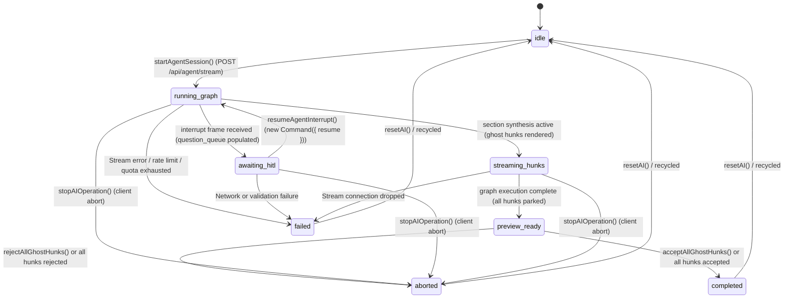

# UI Streaming Architecture & Implementation Specification

## 1. Executive Overview

This document specifies the architecture and implementation of the **Hybrid Streaming & Snapshot Architecture** in the LUGX platform, restoring real-time perceived UI streaming while guaranteeing absolute data integrity, single-action atomic undo, idempotent quota accounting, and optimistic version protection.

### Primary System Invariant:
> **No network chunk is ever written directly to the active document state, the local IndexedDB database, or the remote database.**
> Streaming tokens update an isolated in-memory ephemeral buffer and view-layer preview overlay. The document is committed in exactly one atomic transaction only after stream completion and server version validation.

---

## 2. Readiness Gates Compliance Matrix (G1 - G13)

| Gate | Specification | Implementation File(s) | Status |
| :--- | :--- | :--- | :--- |
| **G1** | Idempotent transaction record (`credit_ledger_transactions`, replacing legacy `ai_reservations`) with unique `operationId` constraint and conditional state transitions (`RESERVED`, `SETTLED`, `ABORTED_REFUNDED`, `EXPIRED_RELEASED`). | `src/server/db/schema/credit-ledger.ts`<br>`src/server/db/migrations/0013_migrate_to_credit_ledger.sql`<br>`src/server/services/ai-settlement-service.ts` | **Implemented & Consolidated (v0.12.0)** |
| **G2** | Atomic hunk acceptance and incremental debounced document sync (`useEditorAutosave` -> `PUT /api/files/[id]`), superseding the deleted `src/server/actions/ai-commit.ts`. | `src/components/editor/codemirror/extensions/streaming-ghost.ts`<br>`src/hooks/editor/use-editor-autosave.ts`<br>`src/server/routes/files-api.routes.ts` | **Implemented & Consolidated (v0.12.0)** |
| **G3** | Dual-Side Inversion Stop Protocol (TD-05): Instant client abort (< 50ms), reader cleanup, server-side pre-TTFT refund and post-TTFT autonomous commit. | `src/hooks/use-ai-stream.ts`<br>`src/lib/ai/stream-handler.ts`<br>`src/server/routes/agent.routes.ts`<br>`src/test/ai/ai-stream-abort-latency.test.ts` | **Implemented & Hardened (v0.12.0)** |
| **G4** | Deterministic reservation and settlement lifecycle governed by `ai-settlement-service.ts` and `redis-wallet.ts`, superseding the deleted `src/server/actions/ai-ops.ts`. | `src/server/services/ai-settlement-service.ts`<br>`src/lib/metering/redis-wallet.ts` | **Implemented & Consolidated (v0.12.0)** |
| **G5** | Auto-save and sync suspension invariants during active streaming, committing, and conflict states. | `src/hooks/use-editor-orchestrator.ts`<br>`src/client/routes/editor-page.tsx` | **Implemented** |
| **G6** | Stale session and generation guard (`editorGeneration`) preventing old callbacks from applying to new state. | `src/lib/ai/stream-session.ts`<br>`src/hooks/use-ai-stream.ts` | **Implemented** |
| **G7** | Production path integration tests calling real settlement services and schema entities. | `src/test/ai/ai-quota-idempotency.test.ts`<br>`src/test/ai/ai-server-atomic-commit.test.ts`<br>`src/test/metering/ai-settlement-service.unit.test.ts` | **Implemented** |
| **G8** | Multi-byte UTF-8 split boundary tests, NDJSON line framing tests, and 412 conflict tests. | `src/test/ai/ai-stream-parser.test.ts`<br>`src/test/ai/ai-stream-session.test.ts`<br>`src/test/editor/editor-atomic-commit.test.ts` | **Implemented** |
| **G9** | Editor orchestration and authoritative write integration tests with zero regression. | `src/test/editor/editor-orchestration.integration.test.ts`<br>[`docs/architecture/sync/editor-sync-orchestration.md`](../architecture/sync/editor-sync-orchestration.md) | **Validated** |
| **G10** | Feature Flag gating (`AI_STREAMING_ENABLED`) with zero sensitive prompt leakage in server logs. | `src/config/features.config.ts`<br>`src/server/routes/agent.routes.ts` | **Implemented & Enforced** |
| **G11** | Zero-Knowledge AI Safety Gatekeeper: Mandatory non-empty `fileId` with HTTP 400 (`MISSING_FILE_ID`), database ownership check, amber UI badge (`ai-encrypted-badge`), and server-side check against `userVaultProfiles.allowAIOnEncryptedFiles` rejecting encrypted files with HTTP 403 (`AI_PROHIBITED_ON_ENCRYPTED_FILES`) unless opted-in. | `src/components/editor/ai-toolbar.tsx`<br>`src/hooks/use-editor-orchestrator.ts`<br>`src/server/routes/agent.routes.ts`<br>`src/test/ai/ai-stream-fileid-governance.test.ts` | **Implemented & Hardened (v0.12.0)** |
| **G12** | Architectural Agent Presentation & Incremental Sync: Integration of `AgentChatPanel`, `HITLQuestionCard`, and debounced incremental autosave via `useEditorAutosave` (800ms–1000ms), purging legacy 5-operation UI references from `src/app`, `src/components`, and `src/hooks`. | `src/components/agent/chat-panel.tsx`<br>`src/components/agent/hitl-question-card.tsx`<br>`src/components/editor/ai-toolbar.tsx`<br>`src/hooks/use-ai-stream.ts`<br>`src/hooks/use-editor-orchestrator.ts` | **Implemented & Verified (v0.11.0 / Phase 11)** |
| **G13** | Final Purge of Legacy 5-Operation Modules & Full Test Suite Migration: Permanent deletion of the 7 legacy 5-operation modules (`api/ai/stream/route.ts`, `pending-operation-store.ts`, `preview-buffer.ts`, `prompts.ts`, `quota-settlement-reducer.ts`, `ai-commit.ts`, `ai-ops.ts`), cleanup of `models.config.json`, `tiers.config.ts`, `ai/client.ts`, and `ai-contracts.ts`, and migration of all unit, live, and E2E test suites. | `src/config/models.config.json`<br>`src/config/tiers.config.ts`<br>`src/lib/ai/client.ts`<br>`src/server/services/ai-settlement-service.ts`<br>`src/types/ai-contracts.ts`<br>`e2e/specs/06`–`09`, `12` | **Implemented & Verified (v0.12.0 / Phase 12)** |

---

## 3. Dual Atomicity & Incremental Sync Model

To prevent distributed transaction failure modes, the system decouples server quota settlement from client document persistence:

```mermaid
flowchart TD
    Client["Client Session: streaming_hunks -> preview_ready (Parked)"] --> UserChoice{"User Decision Trigger"}
    UserChoice -->|"Accept Hunk(s) (acceptHunk / acceptAllHunks)"| Step1["Step 1: Local Atomic CodeMirror Transaction"]
    UserChoice -->|"Reject Hunk(s) (rejectHunk / rejectAllHunks)"| SettleConsumed["Quota Settled Server-Side as Consumed<br/>Dismantle Ghost Hunk(s) (Doc Pristine, No Refund)"]
    
    Step1 --> Dismantle["Dismantle Accepted Ghost Hunk Decoration"]
    Step1 --> Undo["Push 1 Isolated History Entry (Undoable with single Ctrl+Z)"]
    Step1 --> IDBSync["Write Updated Markdown to IndexedDB (localRevision += 1)"]
    
    IDBSync --> Step2["Step 2: Debounced Incremental Sync (useEditorAutosave 800-1000ms)"]
    Step2 --> VerifyVer["PUT /api/files/[id] with expectedVersion & If-Match ETag"]
    VerifyVer -->|Success (200 OK)| CleanState["Adopt Server ETag & Version (Lean CAS)"]
    VerifyVer -->|Version Conflict (412)| ThreeWay["Automated Diff3 3-Way Merge or Conflict Resolution"]
```

---

## 4. Session Finite State Machine (FSM)

The agent session transitions through 8 deterministic states governed by `src/lib/ai/stream-session.ts`:



---

## 5. NDJSON & Stream Framing Protocol Specification

The `/api/agent/stream` endpoint (superseding the deleted `/api/ai/stream` route in Phase 12) streams framed events over an HTTP response:

### 5.0 Request Contract & Gatekeeper Validation
Requests to `/api/agent/stream` validate the JSON payload against `agentStreamRequestSchema`:
- `prompt` (string, required on new turns): The user instruction text (max 100,000 characters).
- `operationId` (string, optional/generated): Unique identifier for the reservation and ledger idempotency.
- `fileId` / `targetFileIds` (required): Target document UUID(s). Missing or empty values fail closed with HTTP `400 Bad Request` (`MISSING_FILE_ID`).
- `threadId` / `projectId`: LangGraph thread and project workspace identifiers.

#### Server-Side Validation Pipeline:
1. **Authentication:** Validates server session with `getUser()`. Returns HTTP 401 if unauthenticated.
2. **Mandatory fileId Check (LUGX-085):** Rejects missing/empty `fileId` with HTTP 400 (`MISSING_FILE_ID`).
3. **Database Ownership & State:** Queries `schema.files` for `id = fileId` AND `userId = user.id` AND `deletedAt IS NULL`. Missing files return HTTP 404.
4. **Zero-Knowledge Gatekeeper:** If `targetFile.isEncrypted`, queries `schema.userVaultProfiles`. If `allowAIOnEncryptedFiles` is not explicitly `true`, rejects with HTTP 403 (`AI_PROHIBITED_ON_ENCRYPTED_FILES`) before token consumption or quota reservation.
5. **Quota Reservation:** Passes validated non-null `fileId` into `reserveAndUpdateUsage`.

### 5.1 Meta Event
Emitted immediately upon successful quota reservation before AI generation starts:
```json
{"type":"meta","sessionId":"session_abc123","reservationId":"res_def456","operationId":"op_ghi789"}
```

### 5.2 Delta Event
Emitted for each incoming token or text chunk from Gemini:
```json
{"type":"delta","text":"Partial generated text..."}
```

### 5.3 Done Event
Emitted on clean EOF stream termination:
```json
{"type":"done"}
```

### 5.4 Error Event
Emitted if an error occurs during stream transmission:
```json
{"type":"error","code":"STREAM_FAILED","message":"Connection timed out","retryable":true}
```

---

## 6. Failure Recovery & Quota Idempotency

### 6.1 Server-Authoritative Quota Settlement (`v0.12.0` / Phase 12)
Client financial authority is revoked: `refundAIReservation`, `commitAIReservation`, `reserveAIQuota`, and `reserveAndUpdateUsage` are strictly internal server functions encapsulated in `src/server/services/ai-settlement-service.ts` and cannot be invoked by clients. Settlement is driven authoritatively by `/api/agent/stream` and `redis-wallet.ts`:
- **Pre-TTFT System Failure / Disconnect (`ttftMs === null`):** Server triggers internal `refundAIReservation(operationId, reason)` or `executeAtomicRefund`:
  - **Condition:** Updates `status = 'ABORTED_REFUNDED'` WHERE `operation_id = operationId AND status = 'RESERVED'`.
  - **Idempotency:** Subsequent calls find `status == 'ABORTED_REFUNDED'` or `'SETTLED'` and return `{ refunded: false, reason: "already_refunded" | "already_committed" }`, eliminating double-refund risks.
  - **Micro-Credit Restoration:** Refunds the reserved micro-credit hold back to `users.credit_balance_micro` and the Redis wallet (`lugx:wallet:${userId}`).
- **Post-TTFT Disconnect / Stream Completion (`ttftMs !== null`):** Server autonomously executes `commitAIReservation(operationId)` or `executeAtomicSettlement` before `{ type: "done" }` or upon socket disconnect, settling quota as consumed for generated tokens.
- **Decoupled Incremental Document Sync (`useEditorAutosave`):** User acceptance applies hunks locally and syncs the updated document via `PUT /api/files/[id]` independently of server-side quota settlement.

### 6.2 Stale Reservation Sweeper (TTL)
`expireStaleReservations()` in `src/server/services/ai-settlement-service.ts` queries all `credit_ledger_transactions` where `status = 'RESERVED'` and `createdAt <= cutoff` (5-minute TTL). It transitions them to `EXPIRED_RELEASED` and refunds the reserved micro-credit amount back to `users.credit_balance_micro`, ensuring abandoned client tabs do not leak quota balances. Authorized via `CRON_SECRET` on `/api/cron/expire-reservations`.

### 6.3 Streaming Terminality & Watchdogs (v1.5.0 Amendment)

Runtime remediation closed four compounding defects that produced an invisible ghost
preview and a perceived infinite send/receive deadlock (full root-cause matrix in
`AI_KEY_ROTATION_AND_STREAMING_RESILIENCE.md` §5a):

- **Single terminal callback, absolutely:** rejections inside the async atomic-commit
  pipeline are routed back into `onError` instead of becoming unhandled promise
  rejections — the ghost is always dismantled, the reservation refunded, and the in-flight
  trigger mutex released.
- **Provider-side cancellation:** the `AbortSignal` is forwarded into Gemini SDK request
  options, so aborts and disconnects terminate the upstream socket.
- **Watchdogs:** first-chunk (`20s`) and absolute-duration (`120s`) ceilings fail closed
  with structured errors (`AI_STREAM_FIRST_CHUNK_TIMEOUT`, `AI_STREAM_DURATION_EXCEEDED`).
- **Preview buffer integrity:** only the latest delta is appended to
  `EphemeralPreviewBuffer` (previously the accumulated text was re-appended per chunk,
  growing it quadratically).

New verification suites: `src/test/ai/ai-stream-completion-terminality.test.ts` (terminality,
watchdog fail-closed) and `src/test/ai/ai-client.test.ts` (signal reaches
SDK request options).

---

## 7. Configuration & Feature Flags

Feature flags are centralized in `src/config/features.config.ts`:
```typescript
export const FEATURES = {
    AI_STREAMING_ENABLED: (import.meta.env?.VITE_AI_STREAMING_ENABLED ?? process.env.VITE_AI_STREAMING_ENABLED) === "true",
    RESERVATION_TTL_MS: 5 * 60 * 1000,
    PREVIEW_BUFFER_MAX_CHARS: 500_000,
};
```
`AI_STREAMING_ENABLED` defaults to `false`; as of v1.5.0 the route handler actively
branches on it — when disabled, generation runs through the `processWithAI` buffered
accumulator path and is framed to the client as a single NDJSON chunk (identical wire
protocol, non-incremental delivery). All modules, schema migrations, and contracts remain
tested and ready for progressive canary activation by setting the flag to `true`.


---

## 8. Unified Agent SSE Stream Protocol (`/api/agent/stream`)

As part of the Elixent autonomous agent architecture (`ELIXENT-ARCH-03` §5.1 & `ELIXENT-ARCH-02`), the unified route `POST /api/agent/stream` serves server-authoritative Server-Sent Events (SSE) for LangGraph state machine execution:

### 8.1 Route Segment & Security Invariants
- **Execution Budget:** `export const maxDuration = 300;` (5-minute serverless execution window) with `export const dynamic = "force-dynamic";`.
- **Pre-Execution Auth Guard:** Invokes `requireAuthenticatedUser()` prior to reading the request body; unauthenticated requests fail immediately with RFC 7807 `401 Unauthorized` (`urn:problem-type:unauthorized`).
- **Fail-Closed Stream Rate Limiting:** Enforces `aiStreamRateLimiter.limit(user.id)`; returns RFC 7807 `429 Too Many Requests` if the user exceeds limits or Redis is unavailable.
- **Strict Payload Schema (`src/core/agent/stream-payload.ts`):** Validated via `parseAgentStreamPayload`:
  - `threadId`: string (max 256 chars, required).
  - `projectId`: string (max 256 chars, required).
  - `prompt`: string (max 100,000 chars, optional).
  - `targetFileIds`: string array (max 100 files, required).
  - `resumePayload`: unknown (optional, passed to `new Command({ resume })`).
  - `ephemeralVaultPayloads`: Record<string, string> (max 100 keys, max 2MB per document, optional).
  - `liveDocumentSnapshots`: Record<string, string> (max 100 keys, max 2MB per document, optional).
  Schema violations return RFC 7807 `400 Bad Request` with `invalidParams` details.

### 8.2 SSE Event Framing (`text/event-stream`)
The route returns an SSE stream with headers `Content-Type: text/event-stream; charset=utf-8`, `Cache-Control: no-cache, no-transform`, and `X-Accel-Buffering: no`:

| Event | Frame Structure | Trigger / Semantics |
| :--- | :--- | :--- |
| `start` | `event: start\ndata: {"type":"start","sessionId":"...","threadId":"...","operationId":"...","correlationId":"..."}\n\n` | Emitted immediately upon successful connection and stream initialization. |
| `update` | `event: update\ndata: {"type":"update","chunk":{...}}\n\n` | Emitted for intermediate graph execution steps, messages, and state transitions. |
| `interrupt` | `event: interrupt\ndata: {"type":"interrupt","threadId":"...","operationId":"...","interrupts":[...]}\n\n` | Emitted when LangGraph suspends for human-in-the-loop input or credit replenishment. |
| `error` | `event: error\ndata: {"type":"error","code":"QUOTA_EXCEEDED"|"STREAM_EXECUTION_ERROR","message":"..."}\n\n` | Emitted on unhandled graph exceptions or quota exhaustion; aborts the stream. |
| `done` | `event: done\ndata: {"type":"done","threadId":"...","operationId":"..."}\n\n` | Emitted upon clean graph completion to signal EOF to the client. |

### 8.3 Metering & Memory Hygiene
- **StreamGovernor Runway Metering:** Initial reservation of 1,200 tokens via `StreamGovernor(userId, operationId, "google/gemini-3.8-flash")`. Every token chunk is metered in real time; if quota is exhausted, governor aborts the stream with `GOVERNOR_QUOTA_EXHAUSTED`.
- **Background Settlement via `scheduleAfterResponse`:** Asynchronous credit settlement persistence is queued via `scheduleAfterResponse(async () => { await flushPendingSettlementsToPostgres(user.id); })`, decoupling database write latency from client stream closure.
- **Zero-Knowledge Buffer Cleansing:** Decrypted file plaintexts loaded into `EphemeralVaultMemoryMap` via `runWithEphemeralVaultScope` are deterministically wiped (`Buffer.fill(0)`) in both normal completion and stream abort/cancel handlers via `zeroOutEphemeralVaultMemory()`.

---

## 9. Architectural Agent Chat Panel, HITL Question Cards & Incremental Editor Sync (Phase 11)

Phase 11 completes the end-to-end integration of the autonomous architectural agent into the client presentation and editing layer:

### 9.1 Agent Chat Panel (`src/components/agent/chat-panel.tsx`)
- **7-Stage Architectural Progress:** Ephemeral visual indicator displaying active graph stages (`Orchestrator`, `Structural Inspection`, `Assumption Analysis`, `Decision Audit`, `Conformal Triage`, `HITL Clarification`, `Document Writer`).
- **ATMS Decision Ledger (`master_ledger`):** Live accordion view rendering committed architectural decisions, rationale summaries, and evaluated alternatives with exclusion reasons.
- **Prompt Composer & Lifecycle Controls:** Provides session initiation, abort (`stopAIOperation`), reset (`resetAI`), and vault lock status badges with automatic dark-theme styling.

### 9.2 Human-in-the-Loop Clarification Gate (`src/components/agent/hitl-question-card.tsx`)
- **Diagnostic Clarification Batches:** Renders clarifying question batches emitted by Stage 6 (`pure_interrupt_node`) upon LangGraph suspension.
- **Contractual Response Validation:** Validates answers in real time against `ClarificationResponseSchema` before enabling the submit action.
- **Stateless Resumption:** Submits validated user responses to `/api/agent/stream` passing `resumePayload`, resuming the graph execution thread with zero duplicate billing.

### 9.3 Client Hook Orchestration (`useAIStream` & `useEditorOrchestrator`)
- **Decoupled Architecture:** `useAIStream` coordinates stream consumption (`consumeAgentStream`), event handling, and multi-hunk ghost state in CodeMirror 6.
- **Programmatic Transaction Isolation:** Dispatches all ghost hunk applications inside `onProgrammaticTransaction`, raising `isProgrammaticUpdateRef` in `useEditorOrchestrator` to prevent false classification as manual user edits.
- **Incremental Sync Contract (412 Elimination):** Ghost hunk acceptance writes directly to local IndexedDB (`localRevision += 1`) and notifies `useEditorAutosave`, coalescing multiple rapid hunk acceptances into a single debounced server save (800ms–1000ms) with matching `expectedVersion`, permanently eliminating self-inflicted 412 Precondition Failed conflicts.

### 9.4 Real-Time Micro-Credit Balance Presentation
- **Server-Authoritative Ledger:** Dashboard (`src/client/routes/dashboard-page.tsx`) and Account (`src/client/routes/account-page.tsx`) pages read live balances via `getCreditBalance()` from `@/client/rpc-client`, invoking `GET /api/rpc/billing/credit-balance` backed server-side by `getUserCreditBalance(user.id)` in `src/server/services/ai-settlement-service.ts`.
- **Percentage Available Indicator:** Renders visual progress bar comparing `currentCredits` against `TIER_LIMITS[tier].creditsDisplay`.
