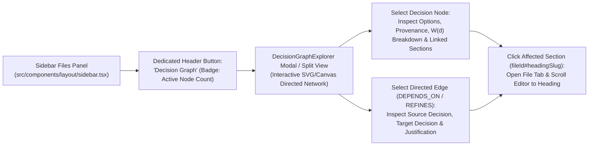

# Software Requirements Specification (SRS-03): Multi-File Editor Tabs, Ghost Review Lifecycle, Interactive Decision Graph UI, and Two-Tier Undo

| Standard Field              | Approved Value                                                                                                                                                                                                                                                                                                                                                 |
| :-------------------------- | :------------------------------------------------------------------------------------------------------------------------------------------------------------------------------------------------------------------------------------------------------------------------------------------------------------------------------------------------------------- |
| **Document ID**             | `ELIXENT-SRS-03-EDITOR-UX-UNDO-v1.1`                                                                                                                                                                                                                                                                                                                           |
| **Classification**          | `SOFTWARE REQUIREMENTS SPECIFICATION (SUBSYSTEM 3 OF 4)`                                                                                                                                                                                                                                                                                                       |
| **Governing ADRs**          | [`ADR-012`](../architecture/adrs/adr_012_json_decision_ledger_and_graph_traversal.md), [`ADR-015`](../architecture/adrs/adr_015_two_tier_workspace_undo_and_turn_rollback.md)                                                                                                                                                                                  |
| **Reference Baseline**      | `Elixent v0.22.0` (`Vite 6 SPA + TanStack Router + Hono RPC`)                                                                                                                                                                                                                                                                                                  |
| **Target Repository Scope** | `../../src/client/routes/workspace-layout.tsx`, `../../src/client/routes/editor-page.tsx`, `../../src/components/editor/**`, `../../src/components/agent/**`, `../../src/components/layout/sidebar.tsx`, `../../src/hooks/use-editor-orchestrator.ts`, `../../src/hooks/use-ai-stream.ts`, `../../src/lib/sync/idb-types.ts`, `../../src/lib/sync/rollback.ts` |
| **Status**                  | `IMPLEMENTED — Phases 4 & 5 (v0.27.0–v0.28.0); Phase 6 E2E Pending` |

## 1. Purpose, Scope & Architectural Traceability

This Software Requirements Specification (**SRS-03**) defines the client-side state models, component contracts, and synchronization protocols for the **Multi-Tab Workspace Editor**, **Three Permission Modes (`safe` / `semi_auto` / `full_auto`)**, **Persistent Multi-File Ghost Review & 3-Way Exit Modal**, **Interactive Decision Graph Network Explorer (`DecisionGraphExplorer`)**, and **Two-Tier Native Undo (`Ctrl + Z` + Turn-Linked Rollback)**.

| Requirement Group           | Governing ADR / Source                                                                 | Target Source Modules                                                                                                                                  | Core Engineering Objective                                                                                                                                                                       |
| :-------------------------- | :------------------------------------------------------------------------------------- | :----------------------------------------------------------------------------------------------------------------------------------------------------- | :----------------------------------------------------------------------------------------------------------------------------------------------------------------------------------------------- |
| **`REQ-PERM-01 .. 03`**     | [`ADR-015`](../architecture/adrs/adr_015_two_tier_workspace_undo_and_turn_rollback.md) | `../../src/components/agent/chat-panel.tsx`, `../../src/hooks/use-ai-stream.ts`                                                                        | Implement `safe`, `semi_auto`, and `full_auto` permission modes governing content edits, file creation, and file deletion approval gates.                                                        |
| **`REQ-TABS-01 .. 04`**     | Direct Product Requirement                                                             | `../../src/client/routes/workspace-layout.tsx`, `../../src/components/editor/markdown/types.ts`, `../../src/hooks/use-editor-orchestrator.ts`          | Provide a top `WorkspaceTabBar` supporting multi-file open tabs, simultaneous multi-file `GhostHunk` state (`ghostHunksByFileId`), and persistent pending edits even after a file tab is closed. |
| **`REQ-EXIT-01 .. 03`**     | Direct Product Requirement                                                             | `../../src/components/editor/unresolved-edits-tracker.tsx`, `../../src/components/editor/pending-edits-exit-modal.tsx` | Provide a persistent `Unresolved Edits Tracker` indicator and a 3-choice navigation/exit guard (`Save & Leave`, `Discard & Leave`, `Stay`).                                                      |
| **`REQ-GRAPH-UI-01 .. 04`** | [`ADR-012`](../architecture/adrs/adr_012_json_decision_ledger_and_graph_traversal.md)  | `../../src/components/layout/sidebar.tsx`, `../../src/components/agent/decision-graph-explorer.tsx`                                    | Provide a dedicated `Decision Graph` button in the Files panel launching an interactive visual network graph of `decisions.ledger.json` nodes and clickable edges.                               |
| **`REQ-UNDO-01 .. 04`**     | [`ADR-015`](../architecture/adrs/adr_015_two_tier_workspace_undo_and_turn_rollback.md) | `../../src/lib/sync/idb-types.ts`, `../../src/lib/sync/rollback.ts`, `../../src/hooks/use-editor-orchestrator.ts`                                      | Implement single-transaction `CodeMirror` `Ctrl + Z` undo for open files and Turn-Linked differential `IDBOperation` + `files.deletedAt` rollback per message/session.                           |

## 2. Three Agent Permission Modes (`REQ-PERM-01 .. 03`)

File: `../../src/components/agent/chat-panel.tsx` & `../../src/hooks/use-ai-stream.ts`

```typescript
export type AgentPermissionMode = "safe" | "semi_auto" | "full_auto";
```

| Permission Mode      | Content Edits (`.md` Sections)                                                                                                                         | File Creation (`createWorkspaceFile`)                    | File Deletion (`deleteWorkspaceFile`)                                                                    | `decisions.ledger.json` Commit                                     |
| :------------------- | :----------------------------------------------------------------------------------------------------------------------------------------------------- | :------------------------------------------------------- | :------------------------------------------------------------------------------------------------------- | :----------------------------------------------------------------- |
| **`safe` (Default)** | Staged as pending `GhostHunk` overlays across affected files; requires explicit user `Accept Hunk` / `Accept All in File` / `Accept All in Workspace`. | Requires explicit user confirmation before writing file. | Pauses at `hitl_clarification_node` for explicit user approval.                                          | Committed upon decision approval; rolled back if turn is reverted. |
| **`semi_auto`**      | Applied and persisted automatically across open and closed files (recorded in `Ctrl+Z` and Turn-Linked `IDBOperation`).                                | Executed automatically across workspace.                 | **Pauses at `hitl_clarification_node` for explicit user approval.**                                      | Committed automatically; reversible via `Revert Turn`.             |
| **`full_auto`**      | Applied and persisted automatically across open and closed files.                                                                                      | Executed automatically.                                  | Executed automatically (soft-deleted via `files.deletedAt = now()`, fully reversible via `Revert Turn`). | Committed automatically; reversible via `Revert Turn`.             |

## 3. Multi-File Editor Tabs, Persistent Pending Ghost Edits & 3-Way Exit Governance (`REQ-TABS-01 .. 04` & `REQ-EXIT-01 .. 03`)

### 3.1. Top File Tab Bar & Multi-File Ghost State Contract (`REQ-TABS-01 .. 03`)

File: `../../src/client/routes/workspace-layout.tsx` & `../../src/hooks/use-editor-orchestrator.ts`

```typescript
export interface WorkspaceOpenTab {
  readonly fileId: string;
  readonly title: string;
  readonly relativePath: string;
  readonly isDirty: boolean;
  readonly isEncrypted: boolean;
  readonly pendingGhostCount: number;
  readonly cursorSelection?: EditorSelection;
  readonly scrollTop?: number;
}

export interface WorkspacePendingGhostStore {
  /** Keyed by fileId -> array of unresolved GhostHunk items */
  readonly ghostHunksByFileId: Readonly<Record<string, readonly GhostHunk[]>>;
  /** Turn ID that proposed each hunk for traceability */
  readonly turnIdByHunkId: Readonly<Record<string, string>>;
}
```

1. **Top `WorkspaceTabBar` Rendering (`REQ-TABS-01`):**
   - Rendered in `WorkspaceLayoutRouteView` (`../../src/client/routes/workspace-layout.tsx`) directly above the editor `<Outlet />`.
   - Clicking a file in `<Sidebar />` opens or activates its tab in `openTabs: WorkspaceOpenTab[]` without unmounting the workspace shell, preserving per-tab cursor selection (`EditorSelection`) and scroll position.
   - When the agent proposes edits in `safe` mode across multiple files (`file_1`, `file_2`, `file_3`), affected files are automatically added to `openTabs` (or updated if already open) displaying a badge with `pendingGhostCount`.
2. **Persistence of Pending Edits Across Tab Closure (`REQ-TABS-02`):**
   - Closing an individual file tab via its `(X)` button removes the tab from `openTabs` view **without** discarding or rejecting its pending entries in `ghostHunksByFileId`.
   - `ghostHunksByFileId` is mirrored into `IndexedDB` (`textai_db_${userId}`) under store key `pending_ghost_hunks_${workspaceId}` so unresolved hunks survive accidental page reloads.
3. **Unresolved Edits Tracker UI (`REQ-TABS-04`):**
   - Component: `../../src/components/editor/unresolved-edits-tracker.tsx`.
   - Whenever `totalPendingGhostCount > 0` across `ghostHunksByFileId`, a persistent indicator pill (`"N Unresolved Edits in M Files"`) is displayed in both the `Sidebar` Files header and the right side of `WorkspaceTabBar`.
   - Clicking the indicator opens a popover listing every file with unresolved `GhostHunk` items (showing whether its tab is currently open or closed), with per-file and workspace-wide buttons:
     - **`Open & Review`**: Opens/focuses the file's tab and scrolls `CodeMirror` to the first pending hunk.
     - **`Accept All in Workspace`** / **`Reject All in Workspace`**.

### 3.2. Three-Choice Exit & Navigation Guard (`REQ-EXIT-01 .. 03`)

Component: `../../src/components/editor/pending-edits-exit-modal.tsx`

Whenever `totalPendingGhostCount > 0` (or `hasUnsavedDirtyBuffer === true`) and the user initiates an action that leaves the active workspace (switching workspaces, navigating to `/dashboard`, `/account`, logging out via `TanStack Router` navigation blocker, or triggering browser `beforeunload` return-to-app flow):

1. Intercept navigation and open `PendingEditsExitModal` presenting **three explicit actions**:
   - **Option 1: `Save & Leave` (`الحفظ والمغادرة`):** Atomically accepts and commits all pending `GhostHunk` items across all files in `ghostHunksByFileId` (and flushes any dirty editor buffer to `IndexedDB`/server), clears `ghostHunksByFileId`, and completes navigation.
   - **Option 2: `Discard & Leave` (`الإلغاء والمغادرة`):** Rejects and purges all pending `GhostHunk` items in `ghostHunksByFileId` (leaving original file contents untouched), discards uncommitted buffer edits, and completes navigation.
   - **Option 3: `Stay` (`البقاء دون حفظ أو تراجع`):** Dismisses the modal, cancels the navigation transition, and leaves all pending `GhostHunk` items and editor buffers intact for continued review.

## 4. Interactive Visual Decision Graph UI (`ADR-012` — `REQ-GRAPH-UI-01 .. 04`)

Component: `../../src/components/agent/decision-graph-explorer.tsx` & `../../src/components/layout/sidebar.tsx`



1. **Dedicated Files-Panel Entry Button (`REQ-GRAPH-UI-01`):**
   - `Sidebar` (`../../src/components/layout/sidebar.tsx`) renders a dedicated **`Decision Graph`** action button at the top of the Files section (alongside a `Download JSON` action). `decisions.ledger.json` is never opened as raw editable text inside the Markdown editor.
2. **Interactive Network Graph Rendering (`REQ-GRAPH-UI-02`):**
   - Renders `DecisionLedgerDocument.nodes` as interactive cards positioned by topological dependency rank (roots on the left/top, dependents flowing right/down) and `DecisionLedgerDocument.edges` as interactive Bézier arrows labeled with `DEPENDS_ON` or `REFINES`.
   - Each node card displays `topicSlug`, `selectedOptionKey`, `impactTier` badge (`CORE_ARCHITECTURAL` vs. `PERIPHERAL`), and `changeWeight.total` ($W(d) \in [10, 100]$).
3. **Edge & Subgraph Inspection (`REQ-GRAPH-UI-03`):**
   - Clicking any **directed edge** highlights the connected pair `(fromDecisionId, toDecisionId)` and opens the Relationship Inspector Drawer showing both decisions side-by-side and the exact `justification` string.
   - Provides a depth selector (`1 Hop`, `2 Hops`, `Full Chain`) allowing the user to visually isolate the upstream dependencies (`dependsOn`) and downstream dependents (`dependedBy`) of any selected decision node.

## 5. Two-Tier Native Undo & Turn-Linked Rollback (`ADR-015` — `REQ-UNDO-01 .. 04`)

### 5.1. Tier 1: Coalesced Single-Transaction `CodeMirror` Undo (`Ctrl + Z`) (`REQ-UNDO-01`)

In `../../src/components/editor/markdown/streaming-ghost.ts` and `../../src/hooks/use-editor-orchestrator.ts`:

- When `acceptAllGhostHunks()` is invoked in `safe` mode, or when `semi_auto` / `full_auto` applies multiple section edits to an open editor buffer via `adapter.replaceRanges(changes)`, all range replacements for that file in that turn MUST be dispatched inside a single `EditorView.dispatch({ changes, annotations: [Transaction.userEvent.of("agent.mutation"), isolateHistory.of("full")] })`.
- Pressing `Ctrl + Z` (`Cmd + Z`) in the editor undoes the entire turn's modifications on the active file in a single step.

### 5.2. Tier 2: Turn-Linked `IDBOperation` & Soft-Delete Rollback (`REQ-UNDO-02 .. 04`)

File: `../../src/lib/sync/idb-types.ts` & `../../src/lib/sync/rollback.ts`

1. **`IDBOperation` Schema Extension (`../../src/lib/sync/idb-types.ts`):**
   ```typescript
   export interface IDBOperation {
     id: string;
     operationId?: string;
     userId?: string;
     workspaceId?: string;
     /** Conversation thread ID when triggered by an agent turn */
     threadId?: string;
     /** Specific chat turn/message ID when triggered by an agent turn */
     turnId?: string;
     fileId: string;
     operationType:
       | "insert"
       | "delete"
       | "update"
       | "create"
       | "rename"
       | "move";
     position: number;
     content: MarkdownSource;
     timestamp: number;
     synced: boolean;
     previousContent?: MarkdownSource;
     isEncrypted?: boolean;
     snapshot?: {
       content: MarkdownSource;
       etag: string;
       version: number;
     };
     postTurnEtag?: string;
   }
   ```
2. **`SyncRollback.rollbackAgentTurn(workspaceId, turnId)` (`../../src/lib/sync/rollback.ts`):**
   - Queries `IndexedDB` `OPERATIONS` store for all records matching `(workspaceId, turnId)` sorted in reverse chronological order:
     - For `operationType === "update"` (covering modified open/closed `.md` files and `decisions.ledger.json`): invokes `this.rollbackOperation(op)` to restore `op.snapshot.content`, `op.snapshot.etag`, and `op.snapshot.version`, updating open editor tabs immediately and queueing server sync.
     - For `operationType === "create"`: soft-deletes the created file (`deletedAt = now()`) and closes its editor tab if open.
     - For `operationType === "delete"`: calls Hono RPC `POST /api/rpc/files/restore` (`deletedAt = null`) to restore the soft-deleted file into the workspace tree and `IndexedDB`.

## 6. Verification & Acceptance Criteria

1. **Multi-Tab & Exit Modal Tests (`../../src/test/editor/`):**
   - Verify opening 3 files in tabs preserves independent selections and pending `GhostHunk` counts, closing a tab with pending hunks retains its hunks in `ghostHunksByFileId` and displays it in `UnresolvedEditsTracker`, and attempting to leave the workspace opens `PendingEditsExitModal` with working `Save & Leave`, `Discard & Leave`, and `Stay` actions.
2. **Two-Tier Undo Tests (`../../src/test/sync/`):**
   - Verify a single `Ctrl + Z` reverses multi-section agent edits in the active editor tab, and clicking `Revert Turn` on an earlier chat message restores modified closed files, un-deletes soft-deleted files (`deletedAt = null`), removes agent-created files, and restores `decisions.ledger.json` to its pre-turn state.
