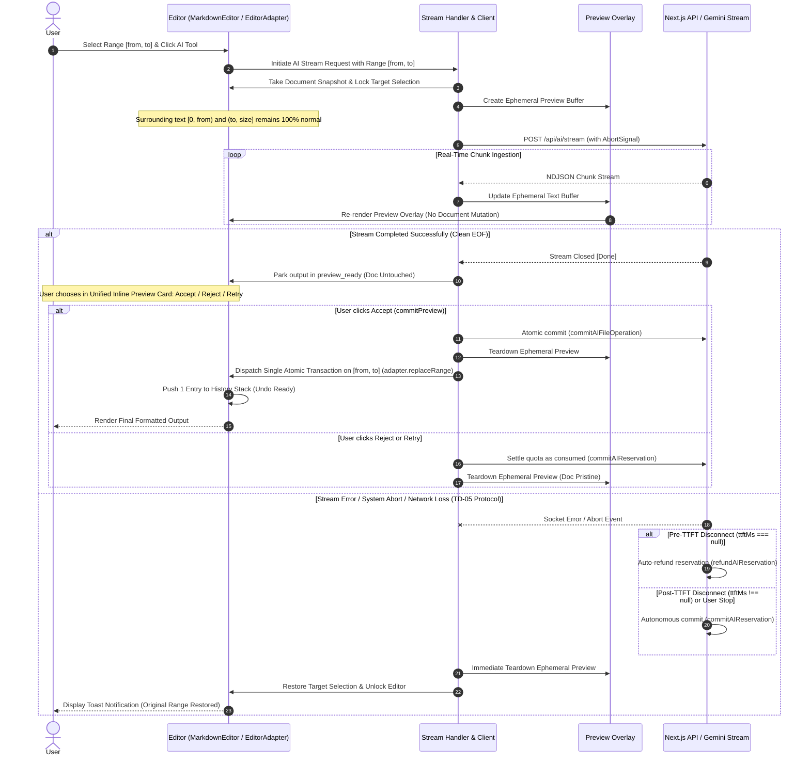
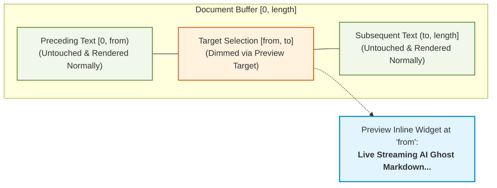

# Architectural Specification: Resilient UI Streaming & Atomic Undo in LUGX Editor

> [!NOTE]
> **Phase 12 Supersession Notice (`v0.12.0`):** In Phase 12, the legacy single-range modules (`src/app/api/ai/stream/route.ts`, `src/server/actions/ai-ops.ts`, `src/server/actions/ai-commit.ts`, `src/lib/ai/preview-buffer.ts`, and `src/components/editor/ai-toolbar.tsx` 5-operation buttons) were permanently superseded by the **Elixent Multi-Hunk Ghost Engine** (`src/components/editor/codemirror/extensions/streaming-ghost.ts`), `src/app/api/agent/stream/route.ts`, `src/server/services/ai-settlement-service.ts`, and incremental editor sync via `useEditorAutosave` (`src/hooks/editor/use-editor-autosave.ts`). See [03_workspace_ast_editor_and_vault_integration.md](../architecture/03_workspace_ast_editor_and_vault_integration.md) for the active multi-hunk specification.

## 1. Executive Summary & Objective

This specification details the architectural design and execution strategy for re-enabling **Real-Time UI Streaming** for AI-assisted editing in the LUGX platform while enforcing **zero data loss**, **uncompromised auto-save isolation**, **granular range selection support**, and **single-action atomic rollback (Single Ctrl+Z undo)**.

---

## 2. Problem Statement & Invariant Guarantees

### 2.1 The Legacy Trade-Off
In previous iterations, real-time UI streaming was replaced with an off-screen buffering pattern (`collectedText` accumulator) due to risks of partial state corruption during mid-stream network aborts or SSE socket disconnects. While this guaranteed data integrity, it imposed a severe UX penalty by inflating the perceived latency.

### 2.2 System Invariants
Any acceptable architectural solution must rigorously satisfy the following five invariants:

1. **Auto-Save Invariance:** The live editor document state MUST NOT be mutated during active streaming **or while a completed result awaits an explicit user decision** (`preview_ready`). No intermediate chunk shall trigger debounced auto-save mutations to IndexedDB or the remote database.
2. **Partial Selection & Scope Invariance (with Non-Colliding Edit Tolerance):** When an operation targets a specific sub-range $[from, to]$ within the document, the preceding content $[0, from)$ and subsequent content $(to, \text{content.length}]$ remain completely interactive and editable. Edits occurring outside the target range dynamically shift $[from, to]$ via `mapPos` without aborting the stream. If an edit directly mutates the target range itself, the stream is safely aborted and the preview dismissed.
3. **Atomic Commit Invariance (Acceptance-Triggered):** Stream completion does NOT mutate the document. The sanitized output is parked in `preview_ready`, and only an explicit user **Accept** applies the AI transformation in exactly ONE atomic transaction targeting $[from, to]$ via `adapter.replaceRange(from, to, previewContent)` (server-first commit confirmed before the local write). **Reject** and **Retry** leave the document fully untouched.
4. **Single-Action Undo Invariance:** Exactly one history entry is produced. A single `Ctrl+Z` (or undo command) restores the original document state and selection range prior to the AI invocation.
5. **Deterministic Rollback Invariance:** If the stream fails, times out, is aborted by the user, or encounters an API error (429/500/503), the ephemeral visual state is purged in $O(1)$ time with zero side effects on the document content.
6. **Explicit Settlement & Dual-Side Inversion Invariance (v1.6.0 & v1.29.2):** Quota refunds apply strictly to pre-TTFT aborts and system failures (startup errors, 412 conflicts). User-driven outcomes — Reject, Retry, Stop-mid-generation (`stopStream`), abandoning a completed preview, or post-TTFT disconnects — settle the reservation as consumed (`commitAIReservation`, idempotent, no document write). Client-side stop execution is instantaneous (< 50ms) with zero blocking network delays (TD-05).

---

## 3. Architecture Design: Ephemeral Decoration Layer Pattern

### 3.1 Ephemeral Preview Layer
Rather than modifying the underlying document model, the stream is rendered through an isolated preview overlay:
* **Rendering Strategy:** 
  - Visual dimming on the selected range being replaced $[from, to]$, giving clear visual context.
  - Live streaming preview banner/widget rendering the generated text with an animated cursor.
* **Storage Isolation:** Because the preview is view-layer metadata maintained by ephemeral React state, `adapter.getValue()` and the underlying document remain pristine throughout the stream lifecycle.

---

### 3.2 Granular Range Handling (Partial Selection vs Full Document)

1. **When text IS selected ($from \neq to$):**
   - The stream targets exactly $[from, to]$.
   - The text preceding $from$ and following $to$ remains rendered completely as-is in the normal editor flow and remains editable.
   - Non-overlapping edits elsewhere in the document dynamically shift $from$ and $to$ via CodeMirror `mapPos`.
   - The streaming widget renders in-place starting at index $from$.
   - On commit, `adapter.replaceRange(from, to, previewMarkdown)` modifies only that slice in a single atomic transaction.
2. **When NO text is selected (Full Document Operation, $from = to = 0$):**
   - The target spans the entire document $[0, \text{content.length}]$.
   - The entire document is dimmed and the streaming widget previews the replacement.

---

## 4. Failure & Recovery Matrix

| Failure Mode | Detection Mechanism | Immediate Action | Recovery State | User Feedback |
| :--- | :--- | :--- | :--- | :--- |
| **Network Disconnection** | `ReadableStream` reader error or `TypeError: Failed to fetch` | Close stream reader, invoke `abortController.abort()` | Document retains 100% of pre-operation text; ghost preview dismantled | Toast notification: *"Connection interrupted. Original content preserved."* with a Retry action |
| **Server / AI Model Error (429/500/503)** | Non-200 HTTP status or error event chunk | Terminate reader loop; do not invoke transaction | Document untouched; lock released | Localized banner / error message detailing error category |
| **Client-Side Explicit Abort** | User clicks *"Stop Generation"* or presses `Escape` | Trigger `abortController.abort()` | Instantly remove ghost preview; re-enable editor interaction | Stream cancelled gracefully; zero leftover artefacts |
| **Tab Closing / Browser Crash** | Browser `beforeunload` or sudden process kill | N/A (Client ceases execution) | IndexedDB and Remote DB retain last clean auto-saved snapshot (unaffected by stream) | Upon next load, document is in clean pre-operation state |
| **Empty or Malformed Stream** | Sanitizer / Parser validation yields empty string or corrupted markup | Reject transaction dispatch | Document remains in pre-operation state | Error toast: *"AI produced an invalid response. No changes applied."* |

---

## 5. Architectural Comparison Matrix

| Evaluation Dimension | Ephemeral Preview Layer (Selected) | Direct Mutation with History Squashing | Shadow DOM / Offscreen Editor | CRDT / Yjs Ephemeral Branching |
| :--- | :--- | :--- | :--- | :--- |
| **Partial Selection Isolation** | **Native & Seamless**: Scoped strictly to $[from, to]$ via `EditorAdapter` coordinates | **Risky**: Document splices can corrupt adjacent node offsets | **Complex**: Requires mapping offsets between two editors | **Complex**: Branch slicing required |
| **Rendering Performance** | **High (60 FPS)**: Minimal DOM repaint scoped to preview overlay | **Medium**: Frequent document reparsing on each chunk | **Low**: Overhead of maintaining dual editor instances | **Medium**: Branch merge overhead |
| **Auto-Save Safety** | **Absolute (100%)**: Zero change events dispatched during streaming | **Vulnerable**: Requires dangerous global auto-save suppression flags | **High**: Isolated to offscreen instance | **High**: Isolated to virtual branch |
| **Undo Stack Determinism** | **Deterministic**: Single atomic `replaceRange` step | **Fragile**: Requires internal history filter manipulation | **Deterministic**: Single patch application | **Complex**: Requires multi-layer rollback |
| **Code Footprint & Maintenance** | **Low**: Single lightweight preview overlay / hook | **High**: Entangled with core editor transaction pipeline | **High**: Synchronization glue code between instances | **Very High**: Heavy CRDT dependencies |

---

## 6. Implementation Modules & Phased Delivery

1. **`src/components/editor/markdown/markdown-editor.tsx`**:
   - Implements CodeMirror 6 standalone Markdown editor and provides `EditorAdapter` interface.
   - Built-in bidirectional (RTL/LTR) layout adaptation.
2. **`src/lib/ai/stream-handler.ts`**:
   - Encapsulates SSE consumption, `AbortController` lifecycle, backpressure handling, and error mapping.
3. **`src/components/editor/ai-toolbar.tsx`**:
   - Active streaming state indicator with instant *"Stop Generation"* action.
4. **`src/app/workspace/editor/[fileId]/page.tsx`**:
   - Integration point connecting `stream-handler`, unified inline `CMStreamingGhostWidget` with embedded controls, and atomic transaction commits on $[from, to]$ via `adapter.replaceRange`.
5. **`src/test/ai/ai-transaction.test.ts`**:
   - Comprehensive unit and integration test suite asserting auto-save isolation, partial range replacement, single-action undo, and failure recovery.
